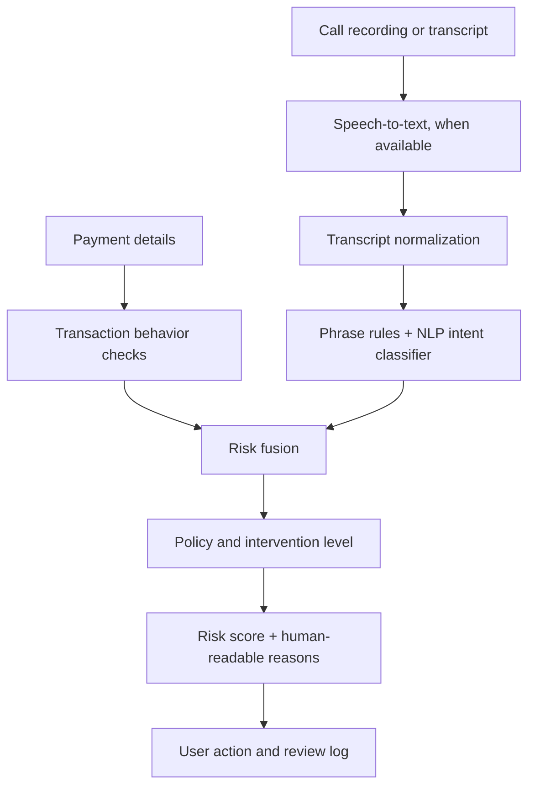

<div align="center">

# 🛡️ FRAUD SHIELD
### Understand the risk before you send the money.

**An explainable fraud-awareness prototype for UPI payments and suspicious phone calls.**

[](https://www.python.org/)
[](https://fastapi.tiangolo.com/)
[](https://scikit-learn.org/)
[](https://railway.com/)

**[Try the live app](https://YOUR-RAILWAY-DOMAIN.up.railway.app)** · **[Explore features](#explore-the-dashboard)** · **[Run locally](#run-it-on-your-machine)**

</div>

> **Demo link:** https://fraud-shield-production-223d6c6f.up.railway.app/

---

## Why Fraud Shield?

A payment may look normal on its own, while a phone call happening at the same time tells a different story. Fraud Shield examines **transaction behavior** and **potentially coercive call language** together, then explains what raised concern and why.

Instead of just labeling a payment as risky, the system provides a score, supporting signals, a plain-language warning, and a simulated user decision flow.

## Explore the dashboard

| Workspace | What you can do |
|:--|:--|
| **Payment Shield** | Choose a payment and call scenario, run a risk check, and inspect the reasons behind the result. |
| **Live Demo** | Compare the same payment with and without suspicious call context; explore how an attack can unfold. |
| **Performance** | Inspect classification results, accuracy measures, and confusion-matrix data derived from the test dataset. |
| **Bank Review** | Review recorded decisions and label outcomes in the demonstration audit workflow. |

**Direct routes:** `/` · `/demo.html` · `/stats.html` · `/review.html`

## How the detection pipeline works



### What gets checked?

- **Payment anomalies:** unfamiliar devices or payees, unusual locations, larger-than-normal amounts, and late-night activity.
- **Rapid activity:** repeated payments and elevated cumulative spending within a short period.
- **Call manipulation:** impersonation, OTP requests, threats, urgency, pressure to transfer money, secrecy, remote-access requests, and digital-arrest language.
- **Context:** transcript normalization, rule-based matching, and a calibrated text classifier help reduce reliance on any single phrase.
- **Explainability:** the dashboard connects flagged signals to a visible risk score and user-facing explanation.

## From detection to decision

The policy layer maps the combined score to four intervention levels:

| Score | Level | Intended experience |
|:--:|:--|:--|
| `0–14` | **APPROVE** | No significant warning detected. |
| `15–29` | **VERIFY** | Encourage a quick second look. |
| `30–59` | **WARN** | Show a clear warning with supporting reasons. |
| `60–100` | **BLOCK** | Show the strongest warning and require deliberate confirmation in the demo. |

> The `BLOCK` label represents a high-severity intervention in this prototype, **not** the ability to freeze a real bank transfer. The user still controls the simulated payment decision.

## Reference evaluation

These are the benchmark figures reported for the project datasets. They are **not** guarantees of accuracy on real-world fraud, and the voice benchmark contains difficult short-form examples.

| Measure | Payment evaluation (600 transactions) | Voice evaluation (92 samples) |
|:--|--:|--:|
| Precision | 94.0% | 95.45% |
| Recall | 94.0% | 29.2% |
| False-positive rate | 0.7% | 5.0% |
| Average evaluation latency | Under 1 ms | 11.36 ms |

Reproduce the numbers with the benchmark scripts shown below. Results can vary with code, models, and runtime environment.

## Technology used

| Layer | Implementation |
|:--|:--|
| Web interface | HTML, CSS, JavaScript |
| API server | Python + FastAPI + Uvicorn |
| Payment analysis | Explainable, weighted behavioral rules |
| Language analysis | Text normalization + deterministic phrase rules |
| Intent prediction | TF-IDF + calibrated linear SVM (scikit-learn) |
| Speech transcription | Faster-Whisper, when supported by the host |
| Artifacts and test data | Joblib models and CSV datasets |
| Deployment | Railway / any compatible Python web host |

## Project layout

```text
Fraud-Shield/
├── app.py                    # API and static-page server
├── risk_engine.py            # Payment behavior analysis
├── risk_policy.py            # Intervention decision logic
├── voice_phishing.py         # Suspicious-call detection
├── text_normalizer.py        # Transcript cleanup
├── nlp_intent.py             # Intent model inference
├── transcription.py          # Audio-to-text support
├── requirements.txt
├── static/                   # Four dashboard pages and assets
├── data/                     # Training and benchmark corpora
├── models/                   # Saved NLP pipeline
├── tests/                    # Automated test suite
└── transactions.csv          # Example payment history
```

## Run it on your machine

**Requirements:** Python 3.12 recommended, Git, and a terminal.

```bash
# Clone the repository
git clone https://github.com/sonalX-hub/Fraud-Shield.git
cd Fraud-Shield

# Create a virtual environment
python -m venv .venv
```

Activate the environment:

- **Windows PowerShell:** `.\.venv\Scripts\Activate.ps1`
- **macOS / Linux:** `source .venv/bin/activate`

Then install and start:

```bash
python -m pip install -r requirements.txt
python -m uvicorn app:app --reload
```

Visit **http://127.0.0.1:8000**.

The repository already includes demonstration transactions and a trained intent model. Retrain only when you want to regenerate those artifacts.

## Validate and experiment

```bash
python -m pytest tests/ -v     # Automated checks
python score_all.py            # Payment evaluation
python evaluate_voice.py       # Call-language evaluation
python generate_data.py        # Recreate synthetic transaction data
python train_intent_model.py   # Retrain the NLP intent model
```

*Note: Dataset generation and model training modify local artifacts; run them deliberately rather than as part of a normal startup.*

## Deploy using Railway

1. Push the project to a GitHub repository.
2. In Railway, create a project with **Deploy from GitHub repo**.
3. Select this repository and configure the service start command:

   ```bash
   uvicorn app:app --host 0.0.0.0 --port $PORT
   ```

4. If using Railpack, set `RAILPACK_PYTHON_VERSION=3.12.11` when needed for dependency compatibility.
5. In **Settings → Networking**, generate a public domain and make sure the domain targets the port on which the app is listening.

Railway may restart services or limit resources based on your plan. Audio transcription can require additional memory and model-download time.

## API at a glance

| Endpoint | Role |
|:--|:--|
| `POST /assess` | Score a payment with optional call context. |
| `POST /transcribe` | Convert uploaded audio to text when transcription is available. |
| `GET /capabilities` | Report available analysis features. |
| `POST /decision` | Record the simulated payment choice. |
| `POST /outcome` | Update a review outcome. |
| `GET /audit` | Retrieve the review log and summary. |
| `GET /stats` | Calculate dataset-based evaluation metrics. |

## Privacy and demo boundaries

Fraud Shield is a **learning and demonstration system**, not a banking integration or a production-ready fraud prevention service.

- Transaction data supplied to the web app is processed by its backend; avoid submitting real banking credentials, OTPs, or sensitive customer data.
- Audio processing uses temporary files for transcription and removes those files afterward; availability depends on server resources.
- Review actions are recorded in a CSV-backed audit workflow. On hosts with ephemeral storage, those records may disappear after a restart or redeploy.
- The provided transaction data is synthetic. Real-world deployment would require stronger validation, authorization, persistence, monitoring, and security review.
- The voice evaluation's low recall on adversarial short samples is a known limitation and an opportunity for improvement.

---

<div align="center">

**Built to make digital-payment risk understandable—not mysterious.**

*Fraud Shield · Explainable payments and call-risk analysis*

</div>
